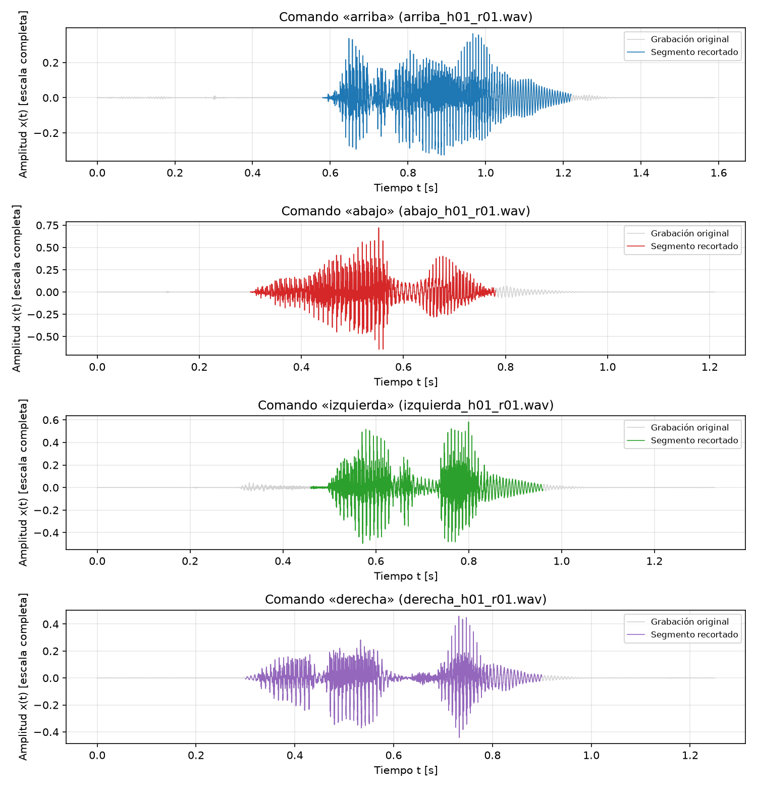
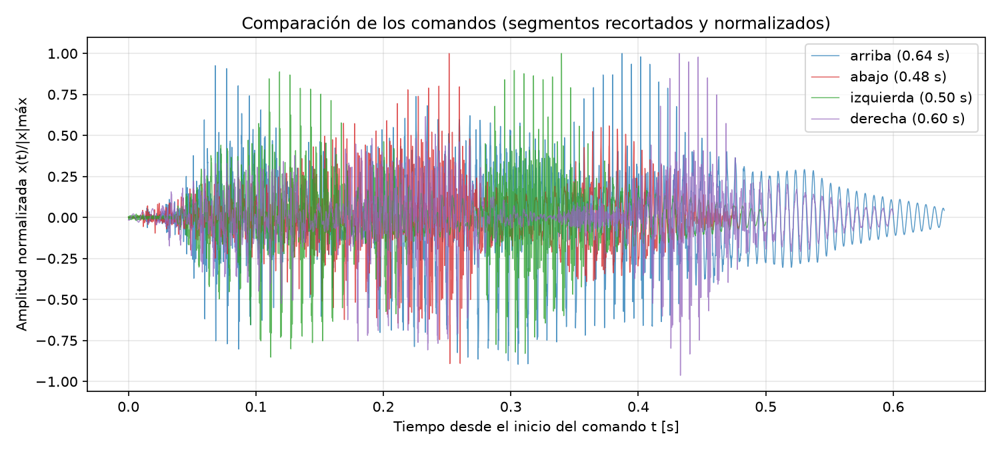
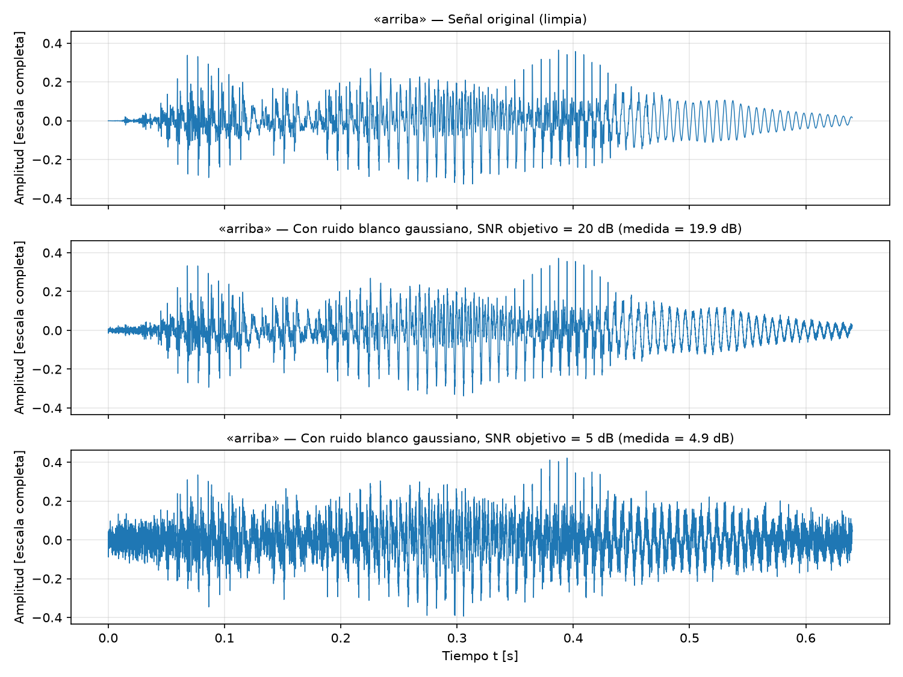
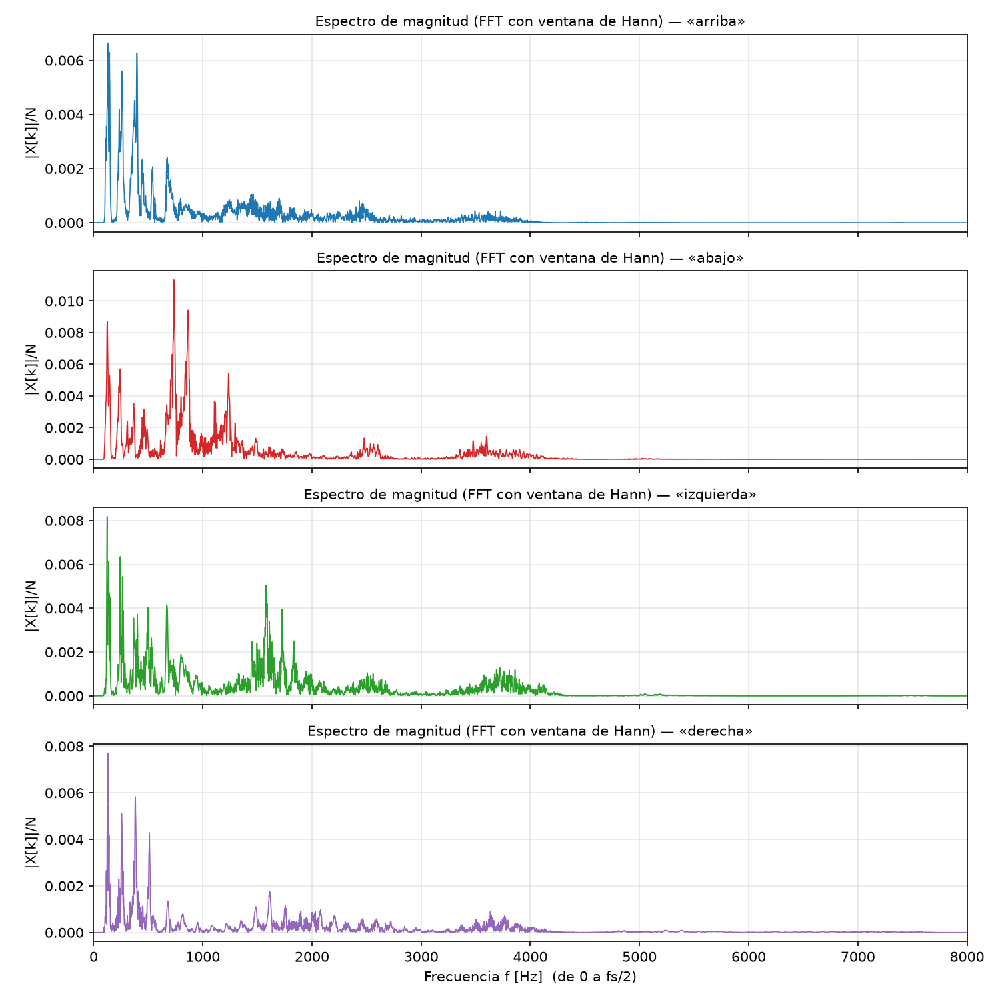
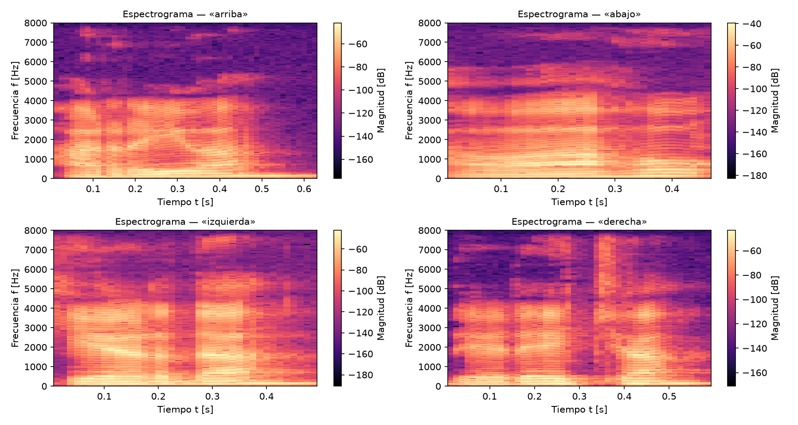

# Reconocimiento de comandos de voz mediante procesamiento de señales

**Universidad de Manizales — Teoría de Señales (2026)**
**Docente:** Milady Cristina Guapacha Montoya
**Integrantes:** Juan José Osorio Isaza · Julián Andrés Hernández Tobón

---

## 1. Descripción

Estudiamos la señal de voz de cuatro comandos en español: **«arriba», «abajo», «izquierda» y «derecha»**, grabados por distintos hablantes. El objetivo final es un sistema que reconozca cada comando a partir de sus características temporales, espectrales y tiempo-frecuencia, y que permita evaluar cómo afecta el ruido al reconocimiento.

## 2. Estado actual (Entrega 2)

| Ya funciona | Falta por desarrollar |
|---|---|
| Carga de grabaciones WAV y documentación de fs, Ts y duración | Ampliar la base de datos (más hablantes y repeticiones) |
| Representación temporal de cada comando | Extracción de MFCC |
| Segmentación del comando (recorte de silencio por energía) | Clasificador (MFCC + kNN/SVM) y métricas (accuracy, matriz de confusión) |
| Normalización por pico | Preprocesamiento adicional (pre-énfasis, filtrado) |
| Caracterización: duración, amplitud, RMS, energía, cruces por cero | Evaluación del reconocimiento en función de la SNR |
| Ruido blanco gaussiano con SNR controlada (20 y 5 dB) | Ruido ambiental real y filtrado para mitigarlo |
| Primer análisis en frecuencia (FFT) y espectrogramas | Separación entrenamiento/prueba por hablante |

## 3. Datos

- **Base propia:** grabaciones hechas por nosotros y otros hablantes, en formato WAV, **16 kHz, mono, 16 bits**.
  Nombre de archivo: `<comando>_h<hablante>_r<repetición>.wav` (por ejemplo `arriba_h01_r01.wav`).
- Cantidad actual: **[COMPLETAR: número de hablantes, repeticiones y total de audios]**.
- En `data/muestras/` está la muestra usada por el código. Base completa: **[COMPLETAR: enlace de Drive]**.
- **Referencia externa:** Google Speech Commands (Warden, 2018), con las palabras en inglés *up, down, left, right*. Se usará como comparación, no como base principal.

**Frecuencia de muestreo:** fs = 16 000 Hz, por lo que Ts = 1/fs = 62.5 µs. Por el criterio de Nyquist se representan componentes hasta fs/2 = 8 kHz, rango donde está la información útil de la voz.

## 4. Cómo ejecutar

Requisitos: Python 3.9 o superior.

```bash
git clone https://github.com/Juan-Osorio-I/proyecto-teoria-senales.git
cd proyecto-teoria-senales
python -m venv .venv
# Windows (PowerShell):  .venv\Scripts\Activate.ps1
# Mac/Linux:             source .venv/bin/activate
pip install -r requirements.txt

python src/analisis.py --datos data/muestras --salida results
```

Esto genera en `results/` la tabla de características (`.csv`) y las cinco figuras descritas en la sección 6.

Estructura del repositorio:

```
src/audio_utils.py   carga, recorte, normalización, ruido, FFT y características
src/analisis.py      script principal: tablas y gráficas
data/                muestras de audio y documentación de los datos
results/             gráficas y tablas generadas
docs/                documentación adicional
```

## 5. Conceptos de Teoría de Señales utilizados

- **Señal en tiempo discreto y muestreo:** x[n] = x(nTs), con Ts = 1/fs; criterio de Nyquist.
- **Dominio temporal:** amplitud, valor medio, valor RMS, energía E = Σ x[n]², duración y cruces por cero.
- **Segmentación por energía** en tramos de 20 ms (la voz es aproximadamente estacionaria en tramos cortos).
- **Normalización** por amplitud pico.
- **Ruido aditivo y relación señal-ruido:** y[n] = x[n] + r[n], con SNR = 10·log₁₀(Pₓ/Pᵣ).
- **Análisis en frecuencia:** DFT/FFT con ventana de Hann, espectro de magnitud de 0 a fs/2.
- **Análisis tiempo-frecuencia:** espectrograma (STFT) con ventana de 25 ms y 50 % de traslape.

## 6. Resultados actuales

> **[COMPLETAR]** Cada subsección debe tener la figura y UN PÁRRAFO que explique qué se observa. Escribirlo con los resultados reales, después de ejecutar `analisis.py` con los audios.

### 6.1 Formas de onda y segmentación


**[COMPLETAR: duración de cada comando, número de «lóbulos» o sílabas visibles, si el recorte detectó bien el inicio y el final, nivel de ruido de fondo.]**

### 6.2 Comparación entre comandos


**[COMPLETAR: qué comando es más largo o más corto y si la duración sola basta para distinguirlos.]**

### 6.3 Caracterización
Tablas completas: `results/tabla_caracteristicas.csv` y `results/resumen_por_comando.csv`.

**[COMPLETAR: tabla corta con duración, pico, RMS, energía y centroide por comando (media ± desviación) y comentario sobre la variabilidad entre hablantes.]**

### 6.4 Efecto del ruido


Ruido blanco gaussiano, semilla 42, SNR = 20 dB y 5 dB.

**[COMPLETAR: cómo cambia la forma de onda con cada nivel de ruido.]**

### 6.5 Espectro (FFT)


El eje horizontal es la frecuencia en Hz (de 0 a fs/2 = 8 kHz) y el vertical la magnitud |X[k]|/N del espectro de un solo lado, calculado con ventana de Hann.

**[COMPLETAR: en qué bandas se concentra la energía de cada comando y en qué se diferencian.]**

### 6.6 Espectrogramas


Ventana de 25 ms con 50 % de traslape.

**[COMPLETAR: cómo cambia el contenido en frecuencia a lo largo de la palabra y qué patrones distinguen un comando de otro.]**

## 7. Referencias

1. Warden, P. (2018). *Speech Commands: A Dataset for Limited-Vocabulary Speech Recognition*. arXiv:1804.03209. https://arxiv.org/abs/1804.03209
2. Davis, S. B., & Mermelstein, P. (1980). Comparison of parametric representations for monosyllabic word recognition in continuously spoken sentences. *IEEE Transactions on Acoustics, Speech, and Signal Processing*, 28(4), 357–366.
3. Oppenheim, A. V., & Schafer, R. W. (2010). *Discrete-Time Signal Processing* (3.ª ed.). Pearson.
4. Rabiner, L. R., & Schafer, R. W. (2010). *Theory and Applications of Digital Speech Processing*. Pearson.
5. Documentación de NumPy, SciPy y Matplotlib.